<p align="center">
  
</p>

# 🚀 Awesome Prompt Engineering & LLM Orchestration 🤖

<p align="center">
  <a href="https://github.com/ishandutta2007/Awesome-Awesome-Awesome"></a>
  <a href="https://discord.gg/jc4xtF58Ve"></a>
  <a href="https://github.com/ishandutta2007/Awesome-Prompt-Engineering-LLM-Orchestration/stargazers"></a>
  <a href="https://github.com/ishandutta2007/Awesome-Prompt-Engineering-LLM-Orchestration/network/members"></a>
  <a href="https://github.com/ishandutta2007/Awesome-Prompt-Engineering-LLM-Orchestration/issues"></a>
  <a href="https://github.com/ishandutta2007/Awesome-Prompt-Engineering-LLM-Orchestration/blob/main/LICENSE"></a>
  <a href="https://github.com/ishandutta2007"></a>
</p>

---

## 🌟 Top Prompt Engineering & LLM Orchestration Ecosystem

> **A rigorously curated directory of SaaS platforms, enterprise LLMOps suites, open-source frameworks, and developer tools for prompt versioning, agent orchestration, automated evals, and production observability.**

* **Focus Areas**: Prompt Management • LLM Observability • Automated Evaluations (Evals) • Multi-Agent Orchestration • Structured Generation • AI Gateway Proxies • LLMOps Pipelines  
* **Current Status**: Maintained & Updated (2026 Edition) ⚡  
* **Target Audience**: AI Engineers, Prompt Architects, LLMOps Practitioners, and Agentic Workflow Builders.

---

## 📑 Table of Contents
- [Sector Overview & Market Dynamics](#-sector-overview--market-dynamics)
- [SaaS/Hosted Platforms](#-saashosted-platforms)
- [Open-Source GitHub Projects](#-open-source-github-projects)
- [Core Architecture Blueprint](#-core-architecture-blueprint)
- [Star History](#-star-history)
- [How to Contribute](#-how-to-contribute)
- [Support & Community](#-support--community)
- [Disclaimer](#-disclaimer)

---

## 📊 Sector Overview & Market Dynamics

The global **Prompt Engineering and LLM Orchestration** market represents one of the fastest-growing layers of the enterprise AI infrastructure stack, expanding rapidly from **~$6.5 Billion** towards an estimated **$35+ Billion by 2032** at a **Compound Annual Growth Rate (CAGR) exceeding 32%**.

Market dynamics exhibit a **moderately fragmented yet rapidly consolidating landscape**: while foundational multi-agent orchestration and evaluation frameworks remain broadly fragmented across diverse developer primitives and OpenTelemetry ecosystems, leading enterprise platforms (such as LangChain/LangSmith and ClickHouse-backed Langfuse) are establishing strong gravity wells through all-in-one tracing, prompt lifecycle governance, and AI gateway infrastructure.

---

## ☁️ SaaS/Hosted Platforms

The following enterprise platforms provide managed prompt engineering registries, continuous regression evaluations, distributed observability, and real-time LLM gateway management. Sorted by company scale (valuation / funding level in descending order):

| SaaS Product | Company Scale (Valuation / Funding) 📈 | Starting Tier Price 💳 | Free Tier / Trial Limit 🎁 | Key Capabilities 🛠️ |
| :--- | :--- | :--- | :--- | :--- |
| **[LangSmith (LangChain)](https://langchain.com)** | **$3.0B Valuation** ($460M raised across Series C) | **$39 / seat / month** (Plus Plan) | **5,000 base traces / month** (14-day retention, 1 seat, free forever) | Enterprise LLMOps platform for tracing, debugging, dataset curation, and automated testing across complex agentic chains. |
| **[Langfuse Cloud](https://langfuse.com)** | **$15.0B Parent Valuation** ($4.5M seed; acquired by ClickHouse) | **$29 / month** (Pro Plan) | **50,000 events & traces / month** (30-day retention, 2 seats, free forever) | Managed production LLM engineering platform with distributed tracing, prompt management, metrics, and user feedback capture. |
| **[Vellum](https://vellum.ai)** | **~$150M Valuation** ($25.5M raised across Series A) | **$30 / month** (Mighty Starter Package) | **Base Plan Free Forever** (1 vCPU, 2 GiB RAM, 6 GiB persistent storage, pay-as-you-go credit pool) | Visual prompt playground, regression test suites, multi-model side-by-side comparisons, and versioned production deployment. |
| **[Promptfoo Cloud](https://promptfoo.dev)** | **~$86M Valuation** ($23.6M raised; acquired by OpenAI Frontier) | **Custom Enterprise Quote** (Contact sales) | **Community Free Forever Plan** (Full testing CLI, 10,000 red-teaming security probes / month) | Automated LLM red-teaming, CI/CD vulnerability scanning, prompt regression testing, and security policy guardrails. |
| **[Helicone Cloud](https://helicone.ai)** | **$25.0M Valuation** ($5.5M seed raised) | **$79 / month** (Pro Plan) | **10,000 requests / month** (1 GB storage, 7-day retention, hobby tier free forever) | One-line proxy AI gateway featuring semantic caching, rate limiting, request logging, cost analytics, and prompt experimentation. |
| **[HoneyHive](https://honeyhive.ai)** | **~$18M Est. Valuation** ($7.4M raised; acquired by Elastic) | **Custom Enterprise Quote** (Contact sales) | **10,000 events / month** (30-day data retention, up to 5 user seats, 1,000 RPM, free forever) | Multi-step agent observability, continuous online evaluations, prompt playground, and fine-tuning dataset curation from production traces. |
| **[PromptLayer](https://promptlayer.com)** | **~$15M Est. Valuation** ($4.8M seed raised) | **$49 / month** (Pro Plan) | **2,500 requests / month** (5 users, 250 eval cell executions, 10MB dataset, free forever) | Middleware prompt registry with visual versioning, collaboration pipelines, prompt CMS, and regression score tracking. |
| **[Humanloop](https://humanloop.com)** | **~$12M Est. Valuation** ($5.0M seed raised; acquired by Anthropic) | **Platform Sunsetting / Enterprise** | **Historical: 10,000 logs / month & 50 eval runs** (Platform sunsetting following Anthropic team acquisition) | Collaborative prompt management, human-in-the-loop annotation workflows, automated evaluations, and latency tracking. |
| **[Agenta Cloud](https://agenta.ai)** | **~$10M Est. Valuation** (~$3.0M pre-seed & seed raised) | **$29 / month** (Starter Plan) | **75 free credits / day + 500 bonus credits** (Up to 2 team members, 1 project, free forever) | End-to-end LLMOps workspace to iterate on prompt templates, evaluate outputs with custom metrics, and deploy endpoints. |
| **[Pezzo Cloud](https://pezzo.ai)** | **~$5M Est. Valuation** (Early-stage venture backed & OSS) | **$0 / month** (Self-hosted & Free Cloud Tier) | **Free Cloud Hobby Tier** (Includes core prompt studio, instant deployment, and telemetry logging) | Developer-first AI operations platform featuring prompt version rollbacks, observability logging, and token cost optimization. |

---

## 🛠️ Open-Source GitHub Projects

The open-source ecosystem provides powerful tools for self-hosted orchestration, programmatic prompt optimization, constrained decoding, and privacy-preserving observability. Sorted by GitHub star count in descending order:

| Open-Source Project | GitHub Community Stars ⭐ | Primary Category 🏷️ | Core Description & Highlights 💡 |
| :--- | :--- | :--- | :--- |
| **[AutoGPT](https://github.com/Significant-Gravitas/AutoGPT)** | [](https://github.com/Significant-Gravitas/AutoGPT/stargazers) | Autonomous Agents | Visionary open-source autonomous AI agent platform orchestrating multi-step LLM tasks with tool execution. |
| **[Dify](https://github.com/langgenius/dify)** | [](https://github.com/langgenius/dify/stargazers) | LLM App Platform | Production-ready LLM application development platform uniting visual agent orchestration, RAG pipelines, and prompt IDE. |
| **[LangChain](https://github.com/langchain-ai/langchain)** | [](https://github.com/langchain-ai/langchain/stargazers) | Orchestration Framework | The foundational framework for composing chained LLM calls, structured tool integrations, and context retrieval. |
| **[LiteLLM](https://github.com/BerriAI/litellm)** | [](https://github.com/BerriAI/litellm/stargazers) | AI Gateway Proxy | High-performance unified proxy server and SDK routing 100+ LLMs in OpenAI format with load balancing and fallbacks. |
| **[CrewAI](https://github.com/crewAIInc/crewAI)** | [](https://github.com/crewAIInc/crewAI/stargazers) | Multi-Agent Systems | Collaborative multi-agent orchestration framework enabling role-playing autonomous agents to execute complex objectives. |
| **[LlamaIndex](https://github.com/run-llama/llama_index)** | [](https://github.com/run-llama/llama_index/stargazers) | Data & RAG Framework | Specialized data ingestion, indexing, and retrieval orchestration framework powering complex RAG and agent architectures. |
| **[LangGraph](https://github.com/langchain-ai/langgraph)** | [](https://github.com/langchain-ai/langgraph/stargazers) | Graph Orchestration | Stateful, cyclic multi-agent graph execution engine with built-in checkpointing and human-in-the-loop approval gates. |
| **[Fabric](https://github.com/danielmiessler/fabric)** | [](https://github.com/danielmiessler/fabric/stargazers) | Prompt Engineering | Modular, open-source framework and crowd-sourced repository of precision system prompts ("Patterns") for developer CLI workflows. |
| **[DSPy](https://github.com/stanfordnlp/dspy)** | [](https://github.com/stanfordnlp/dspy/stargazers) | Prompt Optimization | Stanford NLP's declarative framework for programmatically synthesizing and optimizing LM prompt instructions and weights. |
| **[Langfuse](https://github.com/langfuse/langfuse)** | [](https://github.com/langfuse/langfuse/stargazers) | LLMOps & Tracing | OpenTelemetry-native LLM engineering suite for self-hosted execution tracing, prompt management, and regression evals. |
| **[ChatDev](https://github.com/OpenBMB/ChatDev)** | [](https://github.com/OpenBMB/ChatDev/stargazers) | Multi-Agent Simulation | Multi-agent organizational software development simulation orchestrating simulated programmers, designers, and testers. |
| **[Semantic Kernel](https://github.com/microsoft/semantic-kernel)** | [](https://github.com/microsoft/semantic-kernel/stargazers) | Enterprise SDK | Microsoft's enterprise-grade SDK integrating LLM memory, prompt templating, planner agents, and native plugin connectors. |
| **[Promptfoo](https://github.com/promptfoo/promptfoo)** | [](https://github.com/promptfoo/promptfoo/stargazers) | Automated Evals & Security | Fast CLI and testing framework for automated prompt regression benchmarking, red-teaming, and LLM security audits in CI/CD. |
| **[Opik](https://github.com/comet-ml/opik)** | [](https://github.com/comet-ml/opik/stargazers) | Tracing & Evaluation | Comet's open-source LLM evaluation, dataset experimentation, and end-to-end span tracing platform. |
| **[Guidance](https://github.com/guidance-ai/guidance)** | [](https://github.com/guidance-ai/guidance/stargazers) | Constrained Decoding | Grammar-guided generation library controlling token-level LLM sampling with deterministic regex and JSON schema enforcement. |
| **[Outlines](https://github.com/dottxt-ai/outlines)** | [](https://github.com/dottxt-ai/outlines/stargazers) | Structured Outputs | Blazing-fast structured text generation library guaranteeing strict JSON Schema, Pydantic models, and FSM token constraints. |
| **[Instructor](https://github.com/jxnl/instructor)** | [](https://github.com/jxnl/instructor/stargazers) | Type-Safe Extraction | Elegant, lightweight structured output library powered by Pydantic validation and automatic retry loops across model providers. |
| **[Portkey AI Gateway](https://github.com/Portkey-AI/gateway)** | [](https://github.com/Portkey-AI/gateway/stargazers) | AI Gateway Proxy | Sub-millisecond open-source AI gateway written in TypeScript/Rust for intelligent routing, guardrails, and retries. |
| **[Phoenix](https://github.com/Arize-ai/phoenix)** | [](https://github.com/Arize-ai/phoenix/stargazers) | Observability & Evals | OpenTelemetry-based AI observability, evaluation, and latency tracing notebook/server platform by Arize AI. |
| **[PromptFlow](https://github.com/microsoft/promptflow)** | [](https://github.com/microsoft/promptflow/stargazers) | Workflow Orchestration | Microsoft suite for designing executable DAG workflows connecting prompts, Python tools, and multi-model evals. |
| **[BAML](https://github.com/BoundaryML/baml)** | [](https://github.com/BoundaryML/baml/stargazers) | Prompt DSL | Modern domain-specific language (DSL) for type-safe prompt engineering and resilient structured extraction across languages. |
| **[Helicone](https://github.com/Helicone/helicone)** | [](https://github.com/Helicone/helicone/stargazers) | Observability Proxy | Self-hostable AI observability proxy featuring request logging, semantic caching, prompt versioning, and cost analytics. |
| **[Agenta](https://github.com/Agenta-AI/agenta)** | [](https://github.com/Agenta-AI/agenta/stargazers) | LLMOps Studio | Open-source prompt engineering playground, prompt version registry, and automated evaluation benchmarking toolkit. |
| **[Pezzo](https://github.com/pezzolabs/pezzo)** | [](https://github.com/pezzolabs/pezzo/stargazers) | Prompt Ops Studio | Developer-first prompt studio providing visual template editing, instant version deployment, and observability metrics. |
| **[Mirascope](https://github.com/mirascope/mirascope)** | [](https://github.com/mirascope/mirascope/stargazers) | Pythonic Toolkit | Modular, minimalist LLM abstraction treating prompts as first-class Python functions with type hints and collocated calls. |
| **[PromptDirector](https://github.com/wchao6891/promptdirector)** | [](https://github.com/wchao6891/promptdirector/stargazers) | Prompt Management | Open-source prompt engineering utility engineered to structure, direct, and version complex multi-step prompt pipelines. |

---

## 🏗️ Core Architecture Blueprint

When engineering production-grade LLM applications, modern AI architectures combine components into cohesive layers:

```
┌─────────────────────────────────────────────────────────────┐
│                 Client Application / Web UI                 │
└──────────────────────────────┬──────────────────────────────┘
                               │
▼                              ▼                              ▼
┌─────────────────────────────────────────────────────────────┐
│ 1. AI Gateway & Proxy Layer (LiteLLM / Portkey / Helicone)  │
│    • Semantic Caching  • Rate Limiting  • Cost Optimization │
└──────────────────────────────┬──────────────────────────────┘
                               │
▼                              ▼                              ▼
┌─────────────────────────────────────────────────────────────┐
│ 2. Agent & Workflow Orchestration (LangGraph / CrewAI / DSPy│
│    • Cyclic State Graphs • Memory Management • Tool Calling │
└──────────────────────────────┬──────────────────────────────┘
                               │
▼                              ▼                              ▼
┌─────────────────────────────────────────────────────────────┐
│ 3. Structured Generation (Outlines / Guidance / Instructor) │
│    • Pydantic Schemas • Grammar Constraints • JSON Parsing  │
└──────────────────────────────┬──────────────────────────────┘
                               │
▼                              ▼                              ▼
┌─────────────────────────────────────────────────────────────┐
│ 4. Observability & Automated Evals (LangSmith / Langfuse)   │
│    • OpenTelemetry Spans • Promptfoo Security • Online Eval │
└─────────────────────────────────────────────────────────────┘
```

---

## 📈 Star History

[](https://star-history.dera.page/#ishandutta2007/Awesome-Prompt-Engineering-LLM-Orchestration&type=date&legend=top-left)  
[](https://www.star-history.com/#ishandutta2007/Awesome-Prompt-Engineering-LLM-Orchestration&type=date&legend=top-left)

---

## 🤝 How to Contribute

Contributions are welcome! Help us keep this directory accurate and cutting-edge:

1. 🍴 **Fork the repository** on GitHub.
2. 🌿 **Create a new branch** (`git checkout -b feature/add-new-tool`).
3. 📝 **Add or edit entries** following the established table formats (ensure specific pricing, free tier limits, star badges, and descriptions).
4. ✅ **Ensure accuracy**: Verify links, pricing tiers, and open-source star metrics.
5. 🚀 **Submit a Pull Request** with a clear explanation of the addition.

---

## 💖 Support & Community

If you find this repository valuable for your research, projects, or team workflows:

- ⭐ **Star this repository** to help others discover it!
- 🍴 **Fork and share** with fellow AI engineers and researchers.
- 💬 **Join our community** on [Discord](https://discord.gg/jc4xtF58Ve) for discussions on prompt engineering, agentic systems, and LLMOps.
- ☕ **Buy us a coffee & support ongoing curation**: Consider sponsoring the creator via the [GitHub Sponsor Dashboard](https://github.com/sponsors/ishandutta2007). Your support keeps these awesome lists actively maintained and up-to-date!

---

## ⚖️ Disclaimer

- This is an **independently curated community list** for educational and architectural reference — not an official endorsement of any commercial platform.
- Production LLM orchestration and observability pipelines often log sensitive user inputs and PII. Always ensure proper data redaction, zero-retention policies, RBAC, and regulatory compliance (GDPR, SOC 2, HIPAA) when self-hosting or routing traffic through AI gateways.
- Always pair automated LLM-as-a-Judge evaluations with deterministic assertions (JSON schema validators, unit tests) to prevent evaluation drift.

---

<p align="center">
  <b>Built with ❤️ for AI engineers, prompt architects, LLMOps practitioners, and autonomous agent builders worldwide.</b>
</p>
